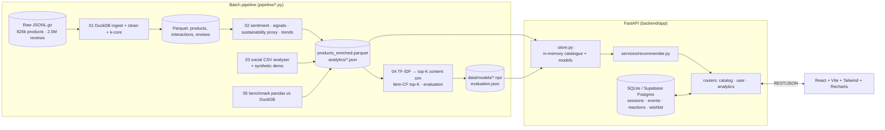
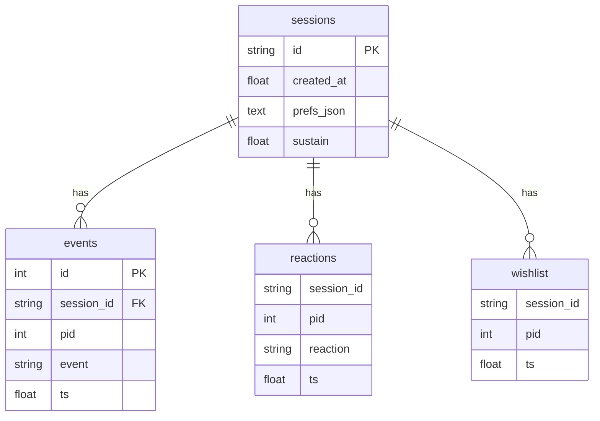

# Architecture

## Components


## Data flow
Raw → **clean** (title/image required, price 0–5000, dedupe listings & user-item pairs, k-core users≥2/items≥3) → **features** (rule taxonomy, TF-IDF 1–2-grams, one-hots) → **analytics** (VADER sentiment, review signals, longevity proxy, trends) → **models** (top-40 neighbour matrices) → **API** → **UI**. Every figure shown in the UI is read from these artifacts.

## Recommendation pipeline
```mermaid
flowchart TD
  E[Session events<br/>view 0.25 · like 1 · wishlist 1.5 · dislike −1] --> U[sparse user profile u]
  U --> C[content = u·C]
  U --> K[cf = u·K]
  PR[Preferences: type/gender/colour/budget] --> PS[pref score]
  POP[Bayesian popularity √n·rating] --> REL
  C --> REL[relevance = wc·content + wk·cf + wp·pref + pop<br/>− dislike penalty; no history → pref+pop]
  K --> REL
  PS --> REL
  REL --> CAND[top-300 candidates, seen items removed]
  CAND --> SUS[final = (1−λ)·relevance + λ·evidence-shrunk longevity]
  SUS --> MMR[MMR diversification on content vectors]
  MMR --> EXP[explanations from the true top contributing item / preference / longevity facts]
```
* **Content similarity** `C[i,j] = cos(TFIDF⊕attributes)`; **CF similarity** `K[i,j] = co(i,j)/(√nᵢnⱼ + 2)`. Scoring a profile is one sparse mat-vec, giving ~14 ms end-to-end.
* **Longevity proxy** = 0.30·Bayesian rating + 0.30·durability mentions (praise − complaints) + 0.25·fit reliability (1 − return/fit complaints) + 0.15·versatility (neutral colour, “goes with everything”); each rate shrunk to the catalogue mean (K = 8) and low-evidence items pulled toward the mean by `sus_confidence = min(1, reviews/15)`.

## Evaluation protocol
Global chronological split at the 80th/90th time percentiles (train / validation / test); models fit only on the past; weights tuned on validation, reported once on test. Relevant = rating ≥ 4 in the test window; history excluded. Metrics: P/R/NDCG@10, coverage, intra-list diversity, latency; paired bootstrap CI vs popularity.

## Database design

`pid` references the product row id in `products_enriched.parquet` (catalogue is columnar/read-only). Same schema in `supabase/schema.sql`.

## API overview (`/docs` for the OpenAPI UI)
| Method & path | Purpose |
|---|---|
| `GET /api/health` | liveness + counts |
| `GET /api/products` (q, category_group, article_type, gender, colour, brand, min/max_price, priced_only, min_sustainability, sort, page, page_size) | catalogue |
| `GET /api/facets` · `GET /api/products/{pid}` | filter options · detail + reviews + related + longevity alternatives + own-before-buy |
| `POST /api/session` · `GET/PUT /api/preferences` | guest session, onboarding preferences, sustainability weight |
| `POST /api/interactions` (view/click/like/dislike/clear_reaction) · `GET /api/reactions` | behaviour signals |
| `GET/POST/DELETE /api/wishlist` | wishlist |
| `GET /api/recommendations` (k, sustain, category_group) | hybrid recommendations + reasons (header `X-Session-Id`) |
| `GET /api/trends` · `/api/sentiment` · `/api/sustainability` | analytics |
| `GET /api/social/demo` · `POST /api/social/analyse` | synthetic demo · analyse an uploaded CSV |
| `GET /api/dashboard` · `/api/evaluation` · `/api/datasets` | dashboard, model results, data lineage + benchmark |
